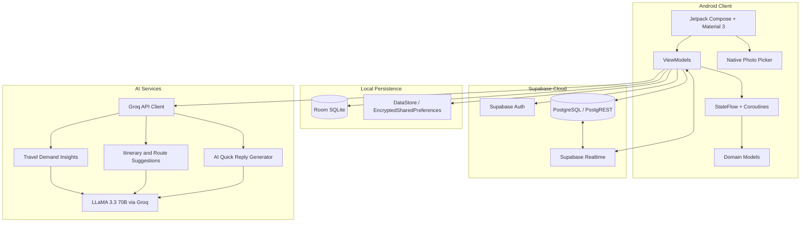

# 🌍 Voyexa: GenAI Travel Planner & Guide Marketplace

<p align="center">
  
  
  
  
  
  
  
</p>

<p align="center">
  <b>An AI-powered Android travel planner and local guide marketplace connecting travellers with local experts.</b>
</p>

<p align="center">
  <a href="https://github.com/debasrita15/Voyexa-Travel-Planner/releases/tag/v1.0.0">Download Voyexa v1.0.0</a>
  ·
  <a href="https://github.com/debasrita15/Voyexa-Travel-Planner">View Repository</a>
</p>

---

## 🌟 Overview

**Voyexa** is a full-stack Android application that combines generative AI travel assistance with a two-sided marketplace for travellers and local tour guides. Built using **Kotlin, Jetpack Compose, Clean Architecture, and MVVM**, the application brings trip planning, guide booking, communication, and AI-powered travel insights into one experience.

Voyexa uses **Groq-hosted LLaMA 3.3 70B** to generate travel-demand insights, itinerary suggestions, and contextual quick replies. **Supabase** provides cloud authentication and data services, while **Room SQLite** supports local persistence for selected data.

## 🎯 Problem Statement

Traditional travel platforms often separate itinerary planning from local guide discovery and may not provide tailored travel-demand insights for local guides.

Voyexa aims to address these challenges by:

- Connecting travellers and local guides through a unified mobile platform.
- Providing guides with AI-generated travel-demand insights and pricing suggestions.
- Generating suggested itineraries, route ideas, local storytelling points, and food stops.
- Supporting local data persistence alongside cloud-backed services.

## ✨ Key Features

- **🤖 AI Travel Insights** — Generate travel-demand insights tailored to a guide's operating city using Groq and LLaMA 3.3 70B.
- **🗺️ Smart Itinerary Suggestions** — Create suggested schedules, route ideas, local storytelling points, and culinary stops.
- **⚡ AI Quick Replies** — Generate contextual reply suggestions to help guides communicate with travellers.
- **🧳 Traveller–Guide Marketplace** — Support traveller trip requests and guide-side accept/reject actions.
- **💬 Booking-Linked Chat** — Enable chat threads for requests accepted by a guide.
- **⭐ Traveller Reviews** — Collect 1–5 star ratings and written feedback for guides.
- **🖼️ Profile Photo Picker** — Use Android's native `ActivityResultContracts.PickVisualMedia` flow for selecting profile images.
- **⚙️ Guide Preferences** — Store operating city, hourly rate, languages, and emergency helpline preferences.
- **📱 Modern Compose UI** — Material 3 components, responsive layouts, edge-to-edge support, and animated interactions.
- **💾 Local and Cloud Persistence** — Use Room SQLite for local data and Supabase for cloud-backed authentication and data.

## 📲 Download and Install

**Latest release:** [Voyexa v1.0.0 on GitHub Releases](https://github.com/debasrita15/Voyexa-Travel-Planner/releases/tag/v1.0.0)

### Installation Steps

1. Open the release page and download the APK asset.
2. Open the downloaded `.apk` file on your Android device.
3. If prompted, allow installation from that source in Android settings.
4. Tap **Install**, then open Voyexa.

> **Note:** If no APK is attached to the release, build the application from source using the setup instructions below.

## 🏗️ Architecture

Voyexa follows a **Clean Architecture + MVVM** approach, separating the UI, state management, domain models, persistence, and external services.

- **UI Layer:** Jetpack Compose and Material 3 screens, including the guide dashboard, booking management, chat, settings, and profile.
- **ViewModel Layer:** Kotlin Coroutines and `StateFlow` for reactive UI state.
- **Domain Layer:** Kotlin models such as `BookingItem`, `ReviewItem`, `TourScheduleItem`, and `AppSettings`.
- **Local Data Layer:** Room SQLite, Preferences DataStore, and EncryptedSharedPreferences.
- **Cloud Data Layer:** Supabase Auth, PostgreSQL through PostgREST, and Realtime subscriptions.
- **AI Layer:** Groq API integration for demand insights, itinerary suggestions, and quick replies.

### System Architecture



## 🔄 Application Flow

1. A user registers or signs in as a **Traveller** or **Guide** through Supabase Auth.
2. A traveller creates a trip request with a destination, dates, and package type.
3. The request appears for guides matching the relevant location.
4. A guide reviews the request and accepts or rejects it.
5. Accepted requests enable the associated traveller–guide chat flow.
6. Guides can access AI-generated travel insights and itinerary suggestions for their operating city.
7. After the tour, the traveller can submit a star rating and written review.

## 🛠️ Tech Stack

| Area | Technologies |
|---|---|
| Language | Kotlin 1.9+ |
| UI | Jetpack Compose, Material 3 |
| Architecture | Clean Architecture, MVVM |
| Asynchronous State | Kotlin Coroutines, StateFlow |
| AI / LLM | Groq API, LLaMA 3.3 70B Versatile |
| Cloud Backend | Supabase Auth, PostgREST, PostgreSQL, Realtime |
| Local Database | Room SQLite, KSP |
| Preferences | Jetpack Preferences DataStore, EncryptedSharedPreferences |
| Networking | OkHttp, Ktor Client |
| Android Media | Activity Result API, `PickVisualMedia` |

## 📁 Project Structure

The following is a high-level view of the application's main layers. Update the structure to match the actual repository before publishing.

```text
Voyexa-Travel-Planner/
├── app/
│   └── src/
│       └── main/
│           ├── java/       # Kotlin source code
│           └── res/        # Android resources
├── build.gradle.kts        # Gradle configuration
├── settings.gradle.kts
└── README.md
```

## 🚀 Setup and Installation

### Prerequisites

- Android Studio (Koala, Ladybug, or a compatible newer version)
- JDK 17 or later
- Android SDK (API 24–35, as specified in the project)
- A [Groq API key](https://console.groq.com/)
- A [Supabase project](https://supabase.com/)

### 1. Clone the Repository

```bash
git clone https://github.com/debasrita15/Voyexa-Travel-Planner.git
cd Voyexa-Travel-Planner
```

### 2. Configure Service Credentials

Configure your Groq and Supabase credentials using the project's existing configuration method. Check the source code and Gradle configuration for the expected property names before adding values.

**Security note:** Never commit API keys, service-role keys, passwords, or other secrets to GitHub. Use local configuration or an appropriate secrets-management mechanism.

### 3. Open and Run the App

1. Open the cloned project in Android Studio.
2. Allow Gradle sync to finish.
3. Confirm that the required SDK and local configuration are available.
4. Select an Android emulator or connect a physical device.
5. Run the application.

## 📈 Engineering Highlights

- **Reactive State Management:** Uses `StateFlow` and unidirectional state flow to connect ViewModels and the Compose UI.
- **Hybrid Persistence:** Combines Room-based local storage with Supabase cloud services for the data flows implemented by the application.
- **Location-Aware AI Prompts:** Supplies guide-city context and relevant parameters to AI requests.
- **Native Android Integration:** Uses the system photo picker for profile-image selection.
- **Responsive UI:** Includes edge-to-edge layouts, keyboard insets, and dark/light theme support as described in the project documentation.

> Performance claims, such as AI responses under 300 ms, should be included as measured results only when reproducible timing data is available for the relevant device, network, and API conditions.

## 👥 Contributors

- **Debasrita Das** — [@debasrita15](https://github.com/debasrita15)
- **Swayam Subham Mishra** — [@SwayamK9](https://github.com/SwayamK9)
- **Esha Agarwal** — [@eshaagarwal1805-hash](https://github.com/eshaagarwal1805-hash)
- **G. Krushna Prasad Achary** — [@G-Krushna](https://github.com/G-Krushna)

## 📜 License

This project is licensed under the **MIT License**. See the [`LICENSE`](LICENSE) file for details.

## ⭐ Support

If you find Voyexa interesting, consider giving the repository a ⭐ on GitHub!
