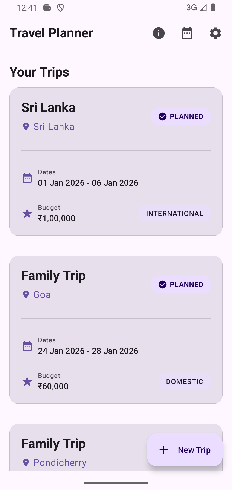
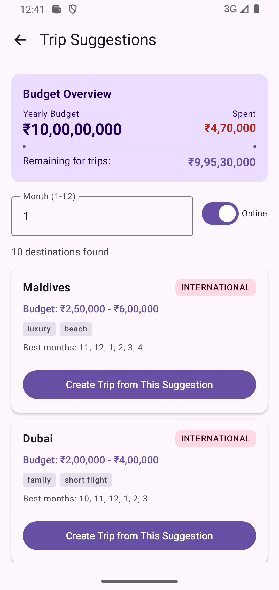
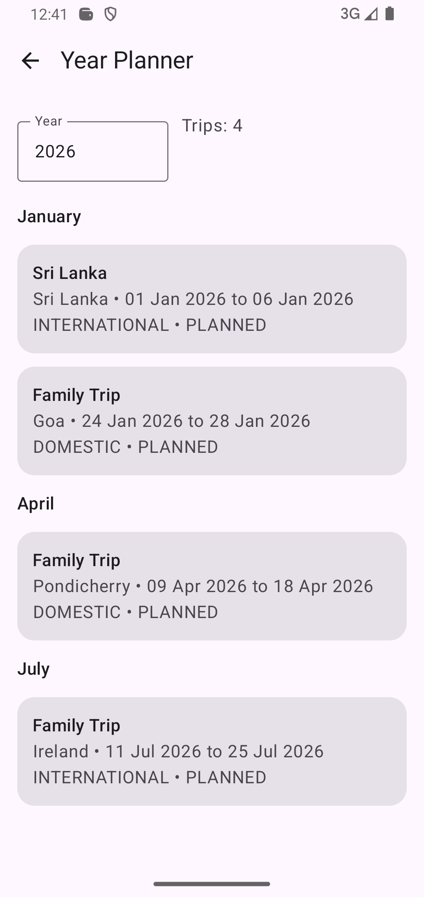
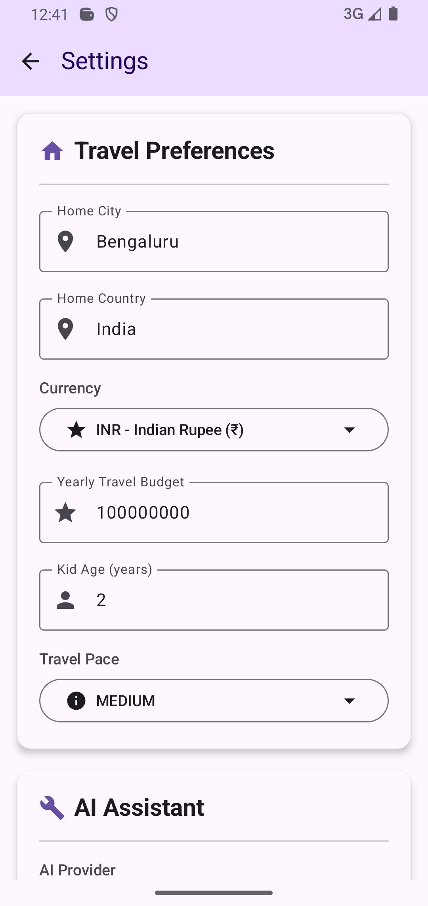
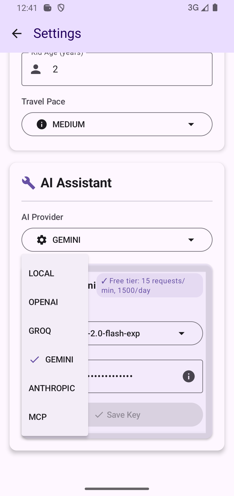
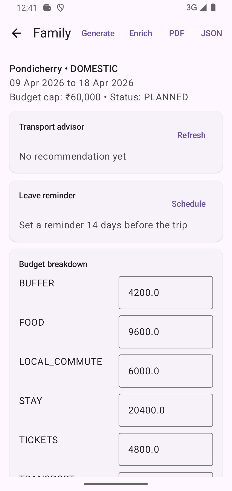
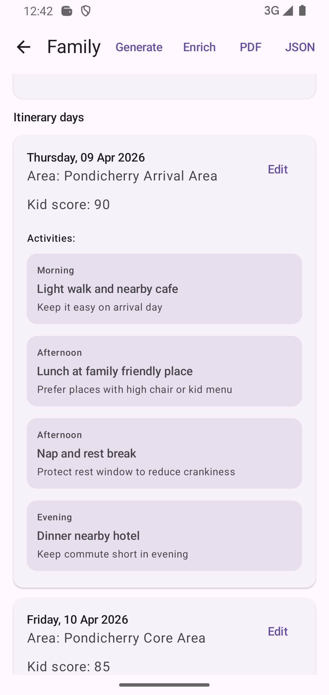

# 🌍 Travel Planner - AI-Powered Trip Planning Assistant

[](https://developer.android.com/)
[](https://kotlinlang.org/)
[](https://developer.android.com/jetpack/compose)
[](https://blog.cleancoder.com/uncle-bob/2012/08/13/the-clean-architecture.html)
[](https://opensource.org/licenses/MIT)

An intelligent Android travel planning application that helps you organize trips with AI-powered itinerary suggestions, budget tracking, and multi-LLM support.

## 📸 Screenshots

<table>
  <tr>
    <td align="center">
      <br/>
      <b>Home Screen</b><br/>
      <sub>View all your trips</sub>
    </td>
    <td align="center">
      <br/>
      <b>Create Trip</b><br/>
      <sub>Easy date picker</sub>
    </td>
    <td align="center">
      <br/>
      <b>Trip Details</b><br/>
      <sub>AI-enriched itinerary</sub>
    </td>
    <td align="center">
      <br/>
      <b>Suggestions</b><br/>
      <sub>Location-based ideas</sub>
    </td>
  </tr>
  <tr>
    <td align="center">
      <br/>
      <b>Settings</b><br/>
      <sub>Multi-LLM setup</sub>
    </td>
    <td align="center">
      <br/>
      <b>Year Planner</b><br/>
      <sub>Calendar overview</sub>
    </td>
    <td align="center">
      <br/>
      <b>Budget Tracking</b><br/>
      <sub>Visual progress</sub>
    </td>
  </tr>
</table>


## ✨ Features

### 🎯 Core Features
- **Smart Trip Planning** - Create and manage trips with automatic itinerary generation
- **AI-Powered Enrichment** - Enhance your trips with suggestions from multiple LLM providers
- **Budget Tracking** - Track spending across trips with visual budget overview
- **Location-Based Suggestions** - Get destination recommendations based on your location and budget
- **Multi-Currency Support** - 20+ currencies with auto-detection
- **Packing List Generator** - Automatic packing suggestions based on trip details
- **Year Planner** - Visual calendar view of all your trips

### 🤖 AI Integration
- **Multiple LLM Providers**:
  - OpenAI (GPT-4o-mini, GPT-4o, GPT-3.5-turbo)
  - Google Gemini (2.0-flash-exp, 1.5-pro, 1.5-flash)
  - Anthropic Claude (3.5-haiku, 3.5-sonnet, 3-opus)
  - Groq (llama-3.3-70b, mixtral-8x7b)
  - **MCP (Model Context Protocol)** - Combine multiple providers for best results
  - Local fallback mode

### 🌐 Online Features
- **Live Destination Suggestions** - Uses REST Countries API (100% free)
- **250+ Countries** - Real-time data with budget estimates
- **Climate-Aware** - Best travel months based on regional weather
- **Auto-Fallback** - Works offline with cached data

### 💰 Budget Management
- **Automatic Tracking** - Calculates spent vs remaining budget
- **Visual Progress** - Progress bars and charts
- **Multi-Trip Planning** - Plan entire year within budget
- **Real-Time Updates** - Budget updates as you confirm trips

---

## 📱 Screenshots

| Home Screen | Trip Details | Suggestions | Settings |
|------------|--------------|-------------|----------|
| Manage all trips | AI-enriched itinerary | Location-based suggestions | Multi-LLM setup |

---

## 🏗️ Architecture

This project follows **Clean Architecture** principles by Uncle Bob:

```
┌─────────────────────────────────────┐
│   UI Layer (Presentation)           │
│   - Jetpack Compose UI              │
│   - ViewModels (MVVM)               │
│   - Sealed class states             │
└──────────────┬──────────────────────┘
               │ depends on ↓
┌──────────────▼──────────────────────┐
│   Domain Layer (Business Logic)     │
│   - Use Cases                       │
│   - Domain Models                   │
│   - Business Rules                  │
└──────────────┬──────────────────────┘
               │ depends on ↓
┌──────────────▼──────────────────────┐
│   Data Layer (Data Access)          │
│   - Repositories                    │
│   - Room Database                   │
│   - DataStore Preferences           │
└──────────────┬──────────────────────┘
               │ depends on ↓
┌──────────────▼──────────────────────┐
│   Services Layer (External)         │
│   - LLM Clients                     │
│   - REST APIs                       │
│   - PDF/JSON Export                 │
└─────────────────────────────────────┘
```

### 📂 Project Structure

```
app/src/main/java/com/example/travelplanner/
├── app/
│   ├── AppGraph.kt                    # Dependency injection
│   └── TravelPlannerApp.kt           # Application class
├── data/
│   ├── db/                           # Room database
│   │   ├── AppDatabase.kt
│   │   ├── Dao.kt
│   │   └── Entities.kt
│   ├── prefs/                        # DataStore preferences
│   │   └── SettingsStore.kt
│   └── repo/                         # Repositories
│       ├── TripRepository.kt
│       └── SettingsRepository.kt
├── domain/
│   ├── Models.kt                     # Domain models
│   ├── TripSuggestion.kt
│   └── usecase/                      # Business logic
│       ├── CalculateBudgetUseCase.kt
│       └── GetTripSuggestionsUseCase.kt
├── llm/                              # LLM integrations
│   ├── OpenAIClient.kt
│   ├── GeminiClient.kt
│   ├── AnthropicClient.kt
│   ├── GroqClient.kt
│   ├── MCPAggregatorClient.kt
│   └── PromptTemplates.kt
├── services/                         # External services
│   ├── OnlineTripSuggestionService.kt
│   ├── TripSuggestionService.kt
│   ├── BudgetService.kt
│   ├── ItineraryService.kt
│   ├── PackingService.kt
│   ├── PdfExportService.kt
│   └── JsonShareService.kt
├── ui/
│   ├── screens/                      # Compose screens
│   │   ├── HomeScreen.kt
│   │   ├── CreateTripScreen.kt
│   │   ├── TripDetailScreen.kt
│   │   ├── SuggestionsScreen.kt
│   │   ├── SettingsScreen.kt
│   │   ├── YearPlannerScreen.kt
│   │   └── DayEditorScreen.kt
│   ├── navigation/
│   │   ├── NavGraph.kt
│   │   └── Routes.kt
│   └── components/
│       └── AppCard.kt
├── util/                             # Utilities
│   ├── Dates.kt
│   ├── Money.kt
│   ├── Geo.kt
│   └── Notifications.kt
└── workers/                          # Background tasks
    ├── LeaveReminderWorker.kt
    └── WorkScheduler.kt
```

### 🎯 Design Patterns

- **MVVM** (Model-View-ViewModel) for UI layer
- **Repository Pattern** for data access
- **Use Case Pattern** for business logic
- **Dependency Injection** via Service Locator (AppGraph)
- **Observer Pattern** via Kotlin Flow
- **Strategy Pattern** for LLM provider selection

### ✅ SOLID Principles

- **S**ingle Responsibility - Each class has one reason to change
- **O**pen/Closed - Open for extension, closed for modification
- **L**iskov Substitution - Implementations are substitutable
- **I**nterface Segregation - Small, focused interfaces
- **D**ependency Inversion - Depend on abstractions, not concretions

---

## 🚀 Getting Started

### Prerequisites

- Android Studio Hedgehog (2023.1.1) or later
- JDK 17 or higher
- Android SDK 34
- Kotlin 1.9.0+

### Installation

1. **Clone the repository**
   ```bash
   git clone https://github.com/shubhwicked/TravelPlanner.git
   cd TravelPlanner
   ```

2. **Open in Android Studio**
   - File → Open → Select the `TravelPlanner` folder
   - Wait for Gradle sync to complete

3. **Build and Run**
   ```bash
   ./gradlew assembleDebug
   ```
   Or use the Run button in Android Studio

### Configuration

#### 1. Set up LLM API Keys (Optional but Recommended)

The app supports multiple LLM providers. Add API keys in the Settings screen:

**OpenAI:**
- Get API key from [OpenAI Platform](https://platform.openai.com/api-keys)
- Free tier: $5 credit (expires after 3 months)
- Models: gpt-4o-mini ($0.15/1M tokens), gpt-4o, gpt-3.5-turbo

**Groq (Recommended for Free Use):**
- Get API key from [Groq Console](https://console.groq.com/keys)
- Free tier: 14,400 requests/day, 30 requests/minute
- Models: llama-3.3-70b-versatile, mixtral-8x7b

**Google Gemini:**
- Get API key from [Google AI Studio](https://makersuite.google.com/app/apikey)
- Free tier: 60 requests/minute
- Models: gemini-2.0-flash-exp (free), gemini-1.5-pro, gemini-1.5-flash

**Anthropic Claude:**
- Get API key from [Anthropic Console](https://console.anthropic.com/)
- Free tier: $5 credit
- Models: claude-3-5-haiku, claude-3-5-sonnet, claude-3-opus

#### 2. Configure User Preferences

In Settings:
- Set your **Home City** and **Home Country** for location-based suggestions
- Select your **Currency** (auto-detected from device)
- Set **Yearly Travel Budget**
- Configure family preferences (adults count, kid age)

---

## 📖 How to Use

### Creating a Trip

1. Tap the **"+"** button on home screen
2. Enter trip details:
   - Title (e.g., "Family Beach Vacation")
   - Destination
   - Budget
   - Trip type (Domestic/International)
   - Start and end dates
3. Tap **"Create"**

### Generating Itinerary

1. Open a trip from the home screen
2. Tap **"Generate"** button
3. The app automatically creates:
   - Daily itinerary based on trip duration
   - Activity suggestions
   - Budget breakdown
   - Packing list

### AI-Powered Enrichment

1. After generating base itinerary, tap **"Enrich"**
2. The selected LLM will:
   - Analyze your trip details
   - Consider family preferences (kid age, travel pace)
   - Add contextual suggestions
   - Provide time-slot specific activities
3. Enriched activities are marked with "llm" category

### Using MCP (Multi-Provider Mode)

1. Go to **Settings** → **LLM Provider** → Select **MCP**
2. Enable multiple providers (e.g., Groq + Gemini)
3. Add API keys for each selected provider
4. When enriching trips, MCP will:
   - Call all providers in parallel
   - Merge and deduplicate suggestions
   - Score by quality
   - Return best combined results

### Budget Tracking

- View **Budget Overview** in Suggestions screen
- Progress bar shows: Spent / Yearly Budget
- Remaining budget updates automatically
- Only PLANNED and COMPLETED trips count toward budget

### Getting Suggestions

1. Tap **"Suggestions"** from home screen
2. Select travel month (1-12)
3. Toggle **"Online"** for live API suggestions or **"Offline"** for local
4. View suggestions filtered by:
   - Your location
   - Available budget
   - Best travel months
   - Trip type preferences

### Exporting Trips

1. Open trip details
2. Tap the **Share icon** (top-right)
3. Exports as PDF with:
   - Full itinerary
   - Budget breakdown
   - Packing list
   - Trip metadata

---

## 🛠️ Tech Stack

### Core
- **Kotlin** - Primary language
- **Jetpack Compose** - Modern declarative UI
- **Material Design 3** - UI components and theming
- **Coroutines** - Asynchronous programming
- **Flow** - Reactive data streams

### Architecture Components
- **ViewModel** - UI state management
- **Room** - Local SQLite database
- **DataStore** - Preferences storage
- **Navigation Compose** - Type-safe navigation
- **WorkManager** - Background tasks

### Networking
- **OkHttp** - HTTP client
- **Kotlinx Serialization** - JSON parsing

### LLM Integration
- Custom clients for OpenAI, Gemini, Groq, Anthropic
- Model Context Protocol (MCP) aggregation
- Streaming support
- Token counting
- Timeout handling

### Testing
- JUnit 4
- Kotlin Test
- Compose UI Testing
- MockK (recommended for mocking)

### Build Tools
- Gradle Kotlin DSL
- KSP (Kotlin Symbol Processing)
- ProGuard/R8 (code shrinking)

---

## 🔌 API Integration

### REST Countries API

**Purpose**: Live destination suggestions  
**Endpoint**: `https://restcountries.com/v3.1/all`  
**Cost**: 100% Free  
**Rate Limit**: None  

**Features**:
- 250+ countries with capitals
- Regional grouping
- Climate zones for best travel months
- No authentication required

**Implementation**: `OnlineTripSuggestionService.kt`

### LLM APIs

All LLM integrations use:
- Timeout: 60 seconds
- Retry logic: None (graceful failure)
- Streaming: Disabled (batch responses)
- Error handling: Returns local fallback

**Prompt Engineering**:
- Considers user location, budget, kid age
- Provides context about existing itinerary
- Requests specific JSON format
- Time-slot aware suggestions

---

## 🎨 Customization Guide

### Adding a New LLM Provider

1. **Create Client** (`llm/NewProviderClient.kt`):
   ```kotlin
   class NewProviderClient(
       private val apiKeyProvider: () -> String?
   ) {
       suspend fun enrichItinerary(model: String, prompt: String): List<LLMActivitySuggestion> {
           // Implementation
       }
   }
   ```

2. **Add to AppGraph** (`app/AppGraph.kt`):
   ```kotlin
   val newProviderClient: NewProviderClient by lazy {
       NewProviderClient(apiKeyProvider = { settingsRepository.loadNewProviderKey() })
   }
   ```

3. **Update Domain** (`domain/Models.kt`):
   ```kotlin
   enum class LLMProviderType {
       // ...existing...
       NEW_PROVIDER
   }
   ```

4. **Add to UI** (`ui/screens/SettingsScreen.kt`):
   - Add provider to dropdown
   - Add API key input field
   - Add model selector

### Adding a New Currency

1. **Update Money.kt** (`util/Money.kt`):
   ```kotlin
   fun getSupportedCurrencies(): List<Pair<String, String>> {
       return listOf(
           // ...existing...
           "XXX" to "Currency Name"
       )
   }
   ```

2. **Update Service** (`services/OnlineTripSuggestionService.kt`):
   ```kotlin
   private fun getCurrencyMultiplier(currency: String): Double = when (currency) {
       // ...existing...
       "XXX" -> 1.23
       else -> 1.0
   }
   ```

### Adding a New Trip Type

1. **Update Domain** (`domain/Models.kt`):
   ```kotlin
   enum class TripType {
       DOMESTIC,
       INTERNATIONAL,
       NEW_TYPE  // Add here
   }
   ```

2. **Update Suggestions**:
   - `TripSuggestionService.kt` - Add filtering logic
   - `OnlineTripSuggestionService.kt` - Add cost estimation

### Customizing Itinerary Generation

Edit `services/ItineraryService.kt`:

```kotlin
fun generateDays(trip: TripPlanEntity, settings: AppSettings): List<ItineraryDayEntity> {
    // Customize day generation logic
    // Add custom activity categories
    // Adjust time slots
}
```

### Theming

1. **Colors** - Modify Material Theme in `TravelPlannerApp.kt`
2. **Typography** - Update text styles
3. **Shapes** - Customize card and button shapes

---

## 🧪 Testing

### Running Tests

```bash
# Unit tests
./gradlew test

# Instrumented tests
./gradlew connectedAndroidTest

# Specific test
./gradlew test --tests CalculateBudgetUseCaseTest
```

### Test Coverage

```bash
./gradlew jacocoTestReport
```

### Writing Tests

**Use Case Test Example**:
```kotlin
class CalculateBudgetUseCaseTest {
    @Test
    fun `calculateRemaining returns correct budget info`() = runTest {
        val mockRepo = mockk<TripRepository>()
        every { mockRepo.calculateSpentBudget(2026) } returns 5000.0
        
        val useCase = CalculateBudgetUseCaseImpl(mockRepo)
        val result = useCase.calculateRemaining(2026, 10000.0)
        
        val budgetInfo = result.getOrThrow()
        assertEquals(10000.0, budgetInfo.yearly)
        assertEquals(5000.0, budgetInfo.spent)
        assertEquals(5000.0, budgetInfo.remaining)
    }
}
```

---

## 🐛 Troubleshooting

### Common Issues

**Problem**: LLM enrichment returns no suggestions  
**Solution**: 
- Check API key in Settings
- Verify internet connection
- Check LLM provider status page
- Try different provider or LOCAL mode

**Problem**: Suggestions screen shows no destinations  
**Solution**:
- Toggle to Offline mode
- Adjust budget (increase if too low)
- Try different month
- Set home country in Settings

**Problem**: Budget not updating  
**Solution**:
- Ensure trip status is PLANNED or COMPLETED (not DRAFT)
- Check trip year matches current year in Settings
- Re-open Suggestions screen to refresh

**Problem**: Generate button does nothing  
**Solution**:
- Ensure trip has valid dates
- Check dates are in future
- Verify trip details are complete

### Logs

Enable detailed logging in `build.gradle.kts`:
```kotlin
buildTypes {
    debug {
        isDebuggable = true
        // View logs with: adb logcat | grep TravelPlanner
    }
}
```

---

## 🤝 Contributing

We welcome contributions! Please follow these guidelines:

### Getting Started

1. Fork the repository
2. Create a feature branch (`git checkout -b feature/AmazingFeature`)
3. Commit your changes (`git commit -m 'Add some AmazingFeature'`)
4. Push to the branch (`git push origin feature/AmazingFeature`)
5. Open a Pull Request

### Code Style

- Follow [Kotlin Coding Conventions](https://kotlinlang.org/docs/coding-conventions.html)
- Use meaningful variable names
- Keep functions small (< 20 lines preferred)
- Add KDoc comments for public APIs
- Follow Clean Architecture layers

### Commit Messages

Use conventional commits:
- `feat: Add new feature`
- `fix: Fix bug`
- `refactor: Refactor code`
- `docs: Update documentation`
- `test: Add tests`

### Pull Request Process

1. Update README.md if needed
2. Add tests for new features
3. Ensure all tests pass
4. Update CHANGELOG (if exists)
5. Request review from maintainers

---

## 📄 License

This project is licensed under the MIT License - see below for details:

```
MIT License

Copyright (c) 2026 Travel Planner Contributors

Permission is hereby granted, free of charge, to any person obtaining a copy
of this software and associated documentation files (the "Software"), to deal
in the Software without restriction, including without limitation the rights
to use, copy, modify, merge, publish, distribute, sublicense, and/or sell
copies of the Software, and to permit persons to whom the Software is
furnished to do so, subject to the following conditions:

The above copyright notice and this permission notice shall be included in all
copies or substantial portions of the Software.

THE SOFTWARE IS PROVIDED "AS IS", WITHOUT WARRANTY OF ANY KIND, EXPRESS OR
IMPLIED, INCLUDING BUT NOT LIMITED TO THE WARRANTIES OF MERCHANTABILITY,
FITNESS FOR A PARTICULAR PURPOSE AND NONINFRINGEMENT. IN NO EVENT SHALL THE
AUTHORS OR COPYRIGHT HOLDERS BE LIABLE FOR ANY CLAIM, DAMAGES OR OTHER
LIABILITY, WHETHER IN AN ACTION OF CONTRACT, TORT OR OTHERWISE, ARISING FROM,
OUT OF OR IN CONNECTION WITH THE SOFTWARE OR THE USE OR OTHER DEALINGS IN THE
SOFTWARE.
```

---

## 🙏 Acknowledgments

- **Uncle Bob** - Clean Architecture principles
- **REST Countries** - Free country data API
- **OpenAI, Google, Anthropic, Groq** - LLM APIs
- **Android Jetpack Team** - Compose and architecture components
- **Kotlin Team** - Amazing language and coroutines

---

## 📞 Support

- **Issues**: [GitHub Issues](https://github.com/shubhwicked/TravelPlanner/issues)
- **Pull Requests**: [GitHub Pull Requests](https://github.com/shubhwicked/TravelPlanner/pulls)
- **Email**: shubhwicked@gmail.com

---

## 🗺️ Roadmap

### Version 1.1 (Q2 2026)
- [ ] Collaborative trip planning
- [ ] Trip templates
- [ ] Photo attachments
- [ ] Offline maps integration

### Version 1.2 (Q3 2026)
- [ ] Flight and hotel booking integration
- [ ] Weather forecasts
- [ ] Currency exchange rates
- [ ] Trip sharing to social media

### Version 2.0 (Q4 2026)
- [ ] Web version
- [ ] iOS app
- [ ] Cloud sync
- [ ] Premium features

---

## ⭐ Star History

If you find this project useful, please consider giving it a star!

---

**Made with ❤️ and Kotlin**
